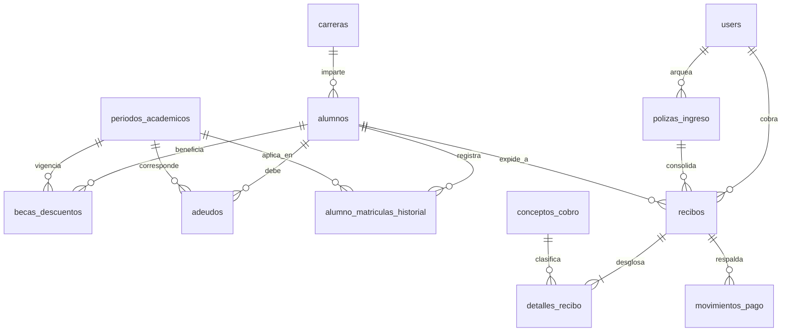

# Diccionario de Datos: Sistema de Control de Caja Universitaria

Este documento define la arquitectura oficial de la base de datos `cajadb` para el **TecNM Campus Monclova**.
Diseñada para cumplir con las reglas del negocio de caja universitaria, trazabilidad contable y respaldo total para el Frontend (Vue 3) y Backend (.NET 10).

---

## 🏛️ Credenciales y Conexión de Desarrollo

* **Motor:** PostgreSQL 17
* **Base de Datos:** `tecnm_caja`
* **Usuario DB:** `postgres`
* **Contraseña DB:** `postgrespassword123`
* **Puerto DB:** `5432`
* **pgAdmin 4 Web:** `http://localhost:5050`
  * **Email pgAdmin:** `admin@tecnm.mx`
  * **Contraseña pgAdmin:** `adminpassword123`

### 🔑 Cuentas de Acceso Predefinidas para Frontend y Backend
| Usuario | Rol | Contraseña | Nombre | Propósito |
| :--- | :--- | :--- | :--- | :--- |
| `admin` | `Admin` | `Password123!` | Administrador General | Gestión de catálogos, arqueos y reportes |
| `cajero1` | `Cajero` | `Password123!` | Cajero Turno Matutino | Operación de cobro matutino |
| `cajero2` | `Cajero` | `Password123!` | Cajero Turno Nocturno | Operación de cobro nocturno |
| `usuario` | `User` | `Password123!` | Usuario Operativo Demo | Consultas de control escolar |

---

## 📋 Modelo de Datos: 13 Tablas Maestras

---

## 1. Módulo Académico y Estudiantes

### `carreras`
Catálogo de oferta educativa universitaria.
* **`id_carrera`** `(INT, PK)`: Identificador oficial heredado del sistema institucional (64, 65, 67, 68, 69, 70, 71, 74).
* **`carrera`** `(VARCHAR(50), NOT NULL)`: Siglas o nombre corto institucional (ej. `Ing. Industrial`).
* **`nombre_carrera`** `(VARCHAR(150), NOT NULL)`: Denominación oficial completa.
* **`titulo`** `(VARCHAR(150))`: Grado académico que otorga.
* **`activo`** `(BOOLEAN, DEFAULT TRUE)`: Estado de vigencia de la carrera.

### `periodos_academicos`
Ciclos escolares para asociar cobros, adeudos, vigencias y reportes.
* **`id_periodo`** `(SERIAL, PK)`: Consecutivo interno autoincrementable.
* **`codigo`** `(VARCHAR(30), UNIQUE, NOT NULL)`: Código semestral (ej. `2012-1`, `2025-2`, `2026-1`).
* **`descripcion`** `(VARCHAR(150))`: Denominación del semestre.
* **`anio`** `(SMALLINT, NOT NULL)`: Año calendario del ejercicio.
* **`ciclo`** `(VARCHAR(20), NOT NULL)`: Tipo (`PRIMAVERA`, `OTONO`, `VERANO`, `VERANILLO`).
* **`fecha_inicio` / `fecha_fin`** `(DATE)`: Rango de fechas del semestre.
* **`activo`** `(BOOLEAN, DEFAULT TRUE)`: Define si es el periodo activo para inscripciones regulares.

### `alumnos`
Padrón maestro de estudiantes y expedientes administrativos.
* **`matricula`** `(VARCHAR(20), PK)`: Identificador oficial institucional del estudiante.
* **`nombre_completo`** `(VARCHAR(160), NOT NULL)`: Nombre completo unificado para búsquedas rápidas.
* **`nombres` / `apellidos`** `(VARCHAR(100))`: Desglose formal para emisión de actas y recibos.
* **`sexo`** `(CHAR(1))`: Género administrativo (`M`, `F`).
* **`id_carrera`** `(INT, FK -> carreras.id_carrera)`: Vínculo relacional con la carrera.
* **`carrera`** `(VARCHAR(100), NOT NULL)`: Nombre en texto plano para visualización rápida.
* **`semestre`** `(INTEGER, NOT NULL)`: Semestre actual del estudiante.
* **`turno`** `(VARCHAR(20), NOT NULL)`: `Matutino`, `Nocturno`, `Vespertino`, `Sabatino`.
* **`numero_ficha`** `(VARCHAR(30))`: Número de ficha de admisión para estudiantes de nuevo ingreso.
* **`cuenta_a`** `(INT)`: Número de cuenta interna escolar (campo `cuentaA`).
* **`estatus`** `(VARCHAR(30), NOT NULL)`: `Inscrito`, `No Inscrito`, `Baja Temporal`, `Baja Definitiva`, `Egresado`.
* **`tiene_beca`** `(BOOLEAN, DEFAULT FALSE)`: Indicador rápido en ventanilla de caja.
* **`porcentaje_beca`** `(NUMERIC(5,2), DEFAULT 0.00)`: Descuento porcentual predeterminado.
* **`created_at`** `(TIMESTAMPTZ)`: Fecha y hora de alta en el sistema.

### `alumno_matriculas_historial`
Trazabilidad de cambios de matrícula para resolver duplicados y proteger el histórico.
* **`id_historial`** `(BIGINT, PK)`: Consecutivo de auditoría.
* **`matricula_alumno`** `(VARCHAR(20), FK -> alumnos.matricula)`: Alumno actual.
* **`matricula_previa`** `(VARCHAR(30), NOT NULL)`: Matrícula anterior que tuvo asignada.
* **`id_periodo`** `(INT, FK -> periodos_academicos.id_periodo)`: Periodo en el que ocurrió el cambio.
* **`fecha_registro`** `(TIMESTAMPTZ)`: Fecha y hora del cambio administrativo.
* **`motivo_cambio`** `(TEXT)`: Justificación autorizada del cambio.

---

## 2. Módulo de Finanzas, Adeudos y Becas

### `becas_descuentos`
Reglas y asignaciones de apoyos económicos aplicables a conceptos de pago.
* **`id_beca`** `(BIGINT, PK)`: Consecutivo de la beca.
* **`matricula`** `(VARCHAR(20), FK -> alumnos.matricula)`: Beneficiario.
* **`id_periodo`** `(INT, FK -> periodos_academicos.id_periodo)`: Periodo de vigencia del beneficio.
* **`tipo_beca`** `(VARCHAR(50), NOT NULL)`: Clasificación (`ACADEMICA`, `DEPORTIVA`, `CONVENIO`, `APOYO_INSTITUCIONAL`).
* **`porcentaje`** `(NUMERIC(5,2))` : Porcentaje aplicable (0.00 - 100.00).
* **`monto_fijo`** `(NUMERIC(12,4))`: Descuento monetario directo (ej. -$100.00).
* **`motivo`** `(VARCHAR(250))`: Justificación.
* **`activa`** `(BOOLEAN, DEFAULT TRUE)`: Validez del apoyo económico.

### `adeudos`
Registro de obligaciones pendientes por año/periodo para adeudos multianuales con concepto uniforme.
* **`id_adeudo`** `(BIGINT, PK)`: Consecutivo del adeudo.
* **`matricula`** `(VARCHAR(20), FK -> alumnos.matricula)`: Alumno deudor.
* **`concepto_cobro`** `(VARCHAR(100), NOT NULL)`: Denominación uniforme (ej. `Pago de Inscripción`).
* **`id_periodo`** `(INT, FK -> periodos_academicos.id_periodo)`: Periodo adeudado (ej. 2024-2 vs 2025-1).
* **`monto_original`** `(NUMERIC(12,4), NOT NULL)`: Total inicial adeudado.
* **`saldo_pendiente`** `(NUMERIC(12,4), NOT NULL)`: Monto restante por liquidar tras abonos.
* **`fecha_limite`** `(DATE)`: Vencimiento de pago.
* **`estado`** `(VARCHAR(20), NOT NULL)`: `PENDIENTE`, `PARCIAL`, `LIQUIDADO`, `CONDONADO`.
* **`created_at`** `(TIMESTAMPTZ)`: Fecha de registro del adeudo.

---

## 3. Módulo de Catálogos de Cobro y Cuentas

### `conceptos_cobro`
Catálogo institucional de conceptos, aranceles y servicios universitarios.
* **`id`** `(UUID, PK)`: Identificador único universal.
* **`clave`** `(VARCHAR(30), UNIQUE, NOT NULL)`: Clave contable institucional (ej. `5200-001-002-004`, `KARD`, `INSC-VIG`).
* **`descripcion`** `(VARCHAR(200), NOT NULL)`: Nombre descriptivo del trámite o concepto.
* **`cuota_base`** `(NUMERIC(12,4), NOT NULL)`: Precio unitario regular.
* **`orden`** `(INT)`: Prioridad de despliegue en la interfaz de caja.
* **`cuenta_referencia`** `(VARCHAR(30))`: Enlace contable institucional superior.
* **`aplica_beca`** `(BOOLEAN, NOT NULL)`: Define si es acreditable a descuentos de beca.
* **`categoria`** `(VARCHAR(50), NOT NULL)`: Agrupador (`Inscripción`, `Cursos`, `Constancias`, `Otros`).
* **`is_active`** `(BOOLEAN, DEFAULT TRUE)`: Estado operativo del arancel.

---

## 4. Módulo de Operación de Caja y Auditoría

### `users`
Cuentas de usuario de empleados, cajeros, supervisores y administradores.
* **`id`** `(UUID, PK)`: Clave primaria de autenticación.
* **`username`** `(VARCHAR(64), UNIQUE, NOT NULL)`: Usuario de inicio de sesión.
* **`email`** `(VARCHAR(254), UNIQUE, NOT NULL)`: Correo electrónico institucional.
* **`password`** `(VARCHAR(512), NOT NULL)`: Hash criptográfico compatible con ASP.NET Identity.
* **`name`** `(VARCHAR(160), NOT NULL)`: Nombre completo del cajero o funcionario.
* **`role`** `(VARCHAR(20), NOT NULL)`: `Admin`, `User`, `Cajero`, `Auditor`.
* **`is_active`** `(BOOLEAN, DEFAULT TRUE)`: Control de acceso al sistema.
* **`created_at`** `(TIMESTAMPTZ)`: Fecha de alta.

### `folios`
Control administrativo para series y folios talonarios (Relación 1 Folio -> N Recibos).
* **`numero_folio`** `(BIGINT, PK)`: Número impreso o identificador de talonario.
* **`serie`** `(VARCHAR(10), NOT NULL DEFAULT 'A')`: Serie del talonario o terminal (`A`, `B`, `C`).
* **`fecha_creacion`** `(TIMESTAMPTZ)`: Momento de emisión del folio.
* **`observaciones`** `(TEXT)`: Notas de auditoría.

### `polizas_ingreso`
Cortes diarios y concentración contable de movimientos de ingresos.
* **`id_poliza`** `(BIGINT, PK)`: Identificador interno de póliza.
* **`numero_poliza`** `(VARCHAR(50), UNIQUE, NOT NULL)`: Código administrativo (ej. `POL-2026-10-001`).
* **`fecha_poliza`** `(DATE, NOT NULL)`: Fecha a la que corresponde el arqueo o corte financiero.
* **`total_recaudado`** `(NUMERIC(12,4), NOT NULL)`: Sumatoria total neta amparada en la póliza.
* **`cajero_usuario`** `(VARCHAR(64), NOT NULL)`: Cajero responsable que cerró el corte.
* **`estado`** `(VARCHAR(20), NOT NULL)`: `ABIERTA`, `CONSOLIDADA`, `CANCELADA`.
* **`created_at`** `(TIMESTAMPTZ)`: Timestamp de generación.

### `recibos`
Comprobante oficial de cobro que documenta la operación en ventanilla con **snapshot histórico**.
* **`id`** `(UUID, PK)`: Clave única universal del recibo.
* **`numero_recibo`** `(BIGINT, UNIQUE, NOT NULL)`: Número consecutivo visible en el comprobante impreso (secuencia `recibos_numero_recibo_seq`).
* **`folio_administrativo`** `(VARCHAR(50), NOT NULL)`: Folio que lo agrupa (no es UNIQUE para admitir 1 Folio -> N Recibos).
* **`fecha_operacion`** `(TIMESTAMPTZ, NOT NULL)`: Momento de captura en el sistema.
* **`fecha_efectiva_pago`** `(TIMESTAMPTZ)`: Fecha real del pago o depósito bancario.
* **`alumno_matricula`** `(VARCHAR(20), FK -> alumnos.matricula)`: Estudiante vinculado.
* **`alumno_nombre` / `alumno_carrera` / `alumno_semestre` / `alumno_turno`**: Datos inmutables fijados al momento del cobro.
* **`metodo_pago`** `(VARCHAR(30), NOT NULL)`: `EFECTIVO`, `DEPOSITO_BANCARIO`, `TRANSFERENCIA`, `TARJETA_DEBITO`, `TARJETA_CREDITO`.
* **`referencia_bancaria`** `(VARCHAR(50))`: Referencia bancaria (no es UNIQUE, puede repetirse bajo condiciones operativas).
* **`cuenta_bancaria`** `(VARCHAR(50))` / **`fecha_bancaria`** `(TIMESTAMPTZ)`: Conciliación bancaria.
* **`subtotal` / `descuento_total` / `total`** `(NUMERIC(12,4), NOT NULL)`: Importes netos auditables.
* **`status`** `(SMALLINT, DEFAULT 1)`: 1 = Activo, 0 = Inactivo.
* **`estado`** `(VARCHAR(20), NOT NULL)`: `REGISTRADO`, `Vigente`, `PREVIO`, `CANCELADO`, `BLOQUEADO`.
* **`tipo_recibo`** `(VARCHAR(20), NOT NULL DEFAULT 'DEFINITIVO')`: `PREVIO` vs `DEFINITIVO`.
* **`is_locked`** `(BOOLEAN, DEFAULT FALSE)`: Control de bloqueo administrativo para edición o consulta.
* **`poliza_id`** `(BIGINT, FK -> polizas_ingreso.id_poliza)`: Póliza que consolida el recibo.
* **`motivo_cancelacion` / `fecha_cancelacion`**: Registro de cancelación.
* **`cajero_usuario` / `cajero_nombre`**: Identificación del cajero responsable.

### `detalles_recibo`
Desglose renglón por renglón de conceptos facturados dentro de cada recibo.
* **`id`** `(UUID, PK)`: Consecutivo del renglón.
* **`recibo_id`** `(UUID, FK -> recibos.id ON DELETE CASCADE)`: Recibo al que pertenece.
* **`concepto_id`** `(UUID, FK -> conceptos_cobro.id ON DELETE SET NULL)`: Arancel correspondiente.
* **`descripcion`** `(VARCHAR(200), NOT NULL)`: Texto impreso en el renglón.
* **`cantidad`** `(INTEGER, NOT NULL)`: Unidades facturadas.
* **`cuota_unitario`** `(NUMERIC(12,4), NOT NULL)`: Precio unitario base.
* **`descuento_beca`** `(NUMERIC(12,4), NOT NULL)`: Deducción por beca o ajuste.
* **`importe_total`** `(NUMERIC(12,4), NOT NULL)`: Total neto por partida.
* **`periodo_ano`** `(VARCHAR(20))`: Semestre al que aplica el cobro.

### `movimientos_pago`
Desglose financiero del dinero ingresado a caja (soporta pagos mixtos y conciliación).
* **`id_movimiento`** `(BIGINT, PK)`: Consecutivo del movimiento financiero.
* **`recibo_id`** `(UUID, FK -> recibos.id ON DELETE CASCADE)`: Recibo amparado.
* **`forma_pago`** `(VARCHAR(30), NOT NULL)`: `EFECTIVO`, `DEPOSITO_BANCARIO`, `TRANSFERENCIA`, `TARJETA_DEBITO`, `TARJETA_CREDITO`.
* **`referencia_bancaria`** `(VARCHAR(100))`: Número de comprobante o autorización.
* **`monto`** `(NUMERIC(12,4), NOT NULL CHECK (monto > 0))`: Cantidad ingresada.
* **`fecha_movimiento`** `(TIMESTAMPTZ)`: Timestamp del ingreso.
* **`cajero_usuario`** `(VARCHAR(64), NOT NULL)`: Cajero que recibió los fondos.

---

## 📊 Vistas SQL Optimizadas para Reportes y Excel

1. **`vw_corte_diario_caja`**:
   Permite al cajero y auditor generar el corte diario y arqueo por fecha y modalidad de pago al instante.
2. **`vw_reporte_recibos_detallado`**:
   Vista desnormalizada con todos los campos clave (alumno, matrícula, carrera, concepto, cantidad, precio, descuento, total, fecha, cajero, estado) lista para filtrar en frontend y exportar a Excel sin joins costosos.
3. **`vw_adeudos_estudiantes`**:
   Agrupa adeudos pendientes con periodo académico, alumno y montos pendientes para validar rápidamente en ventanilla antes de cobrar.
